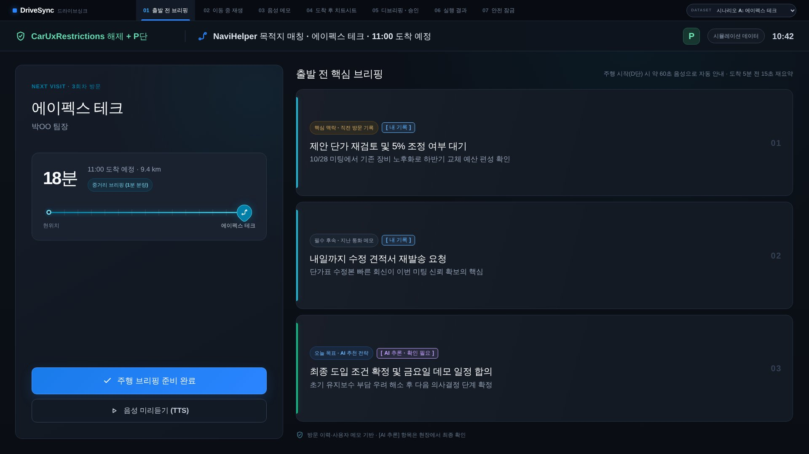
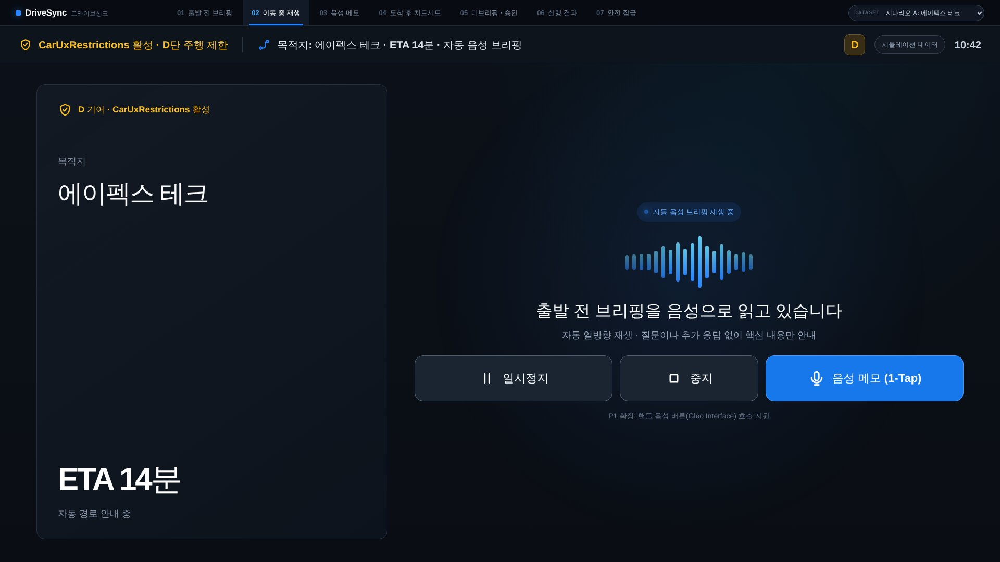
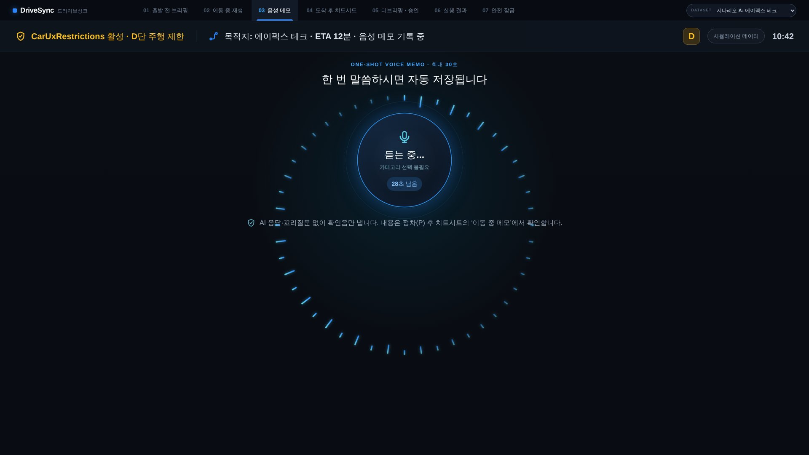
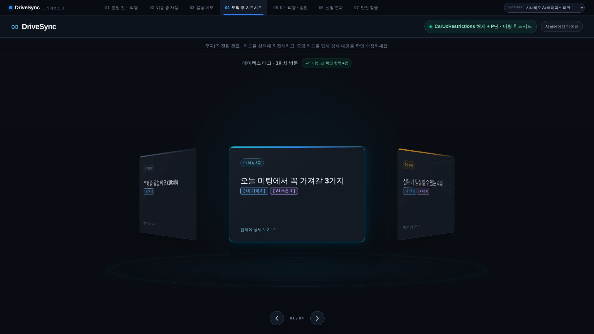
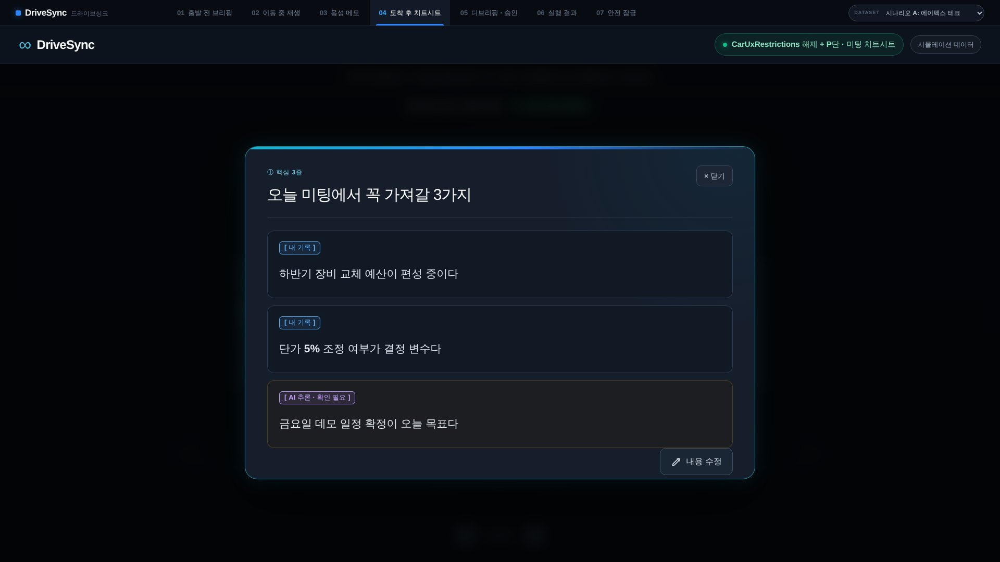
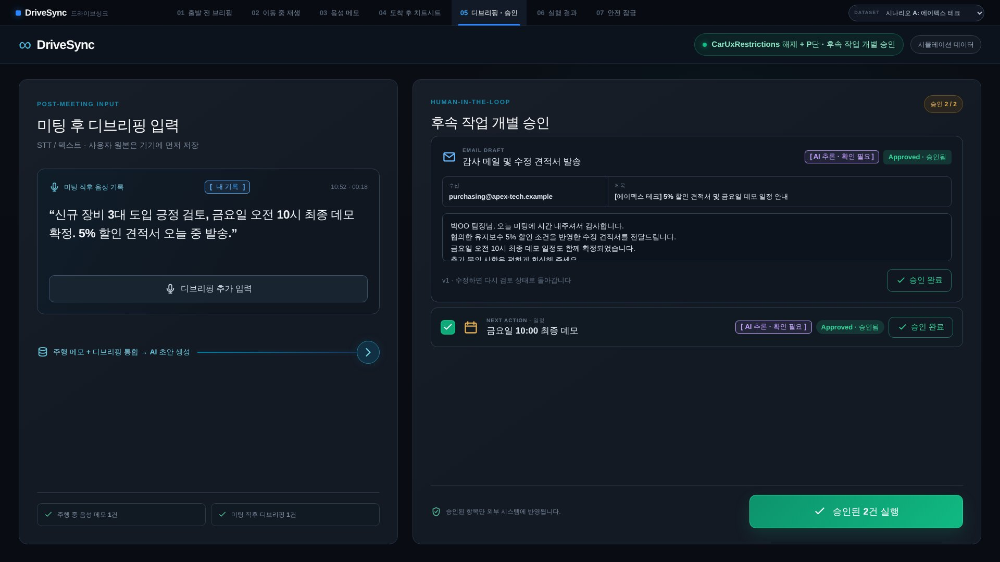
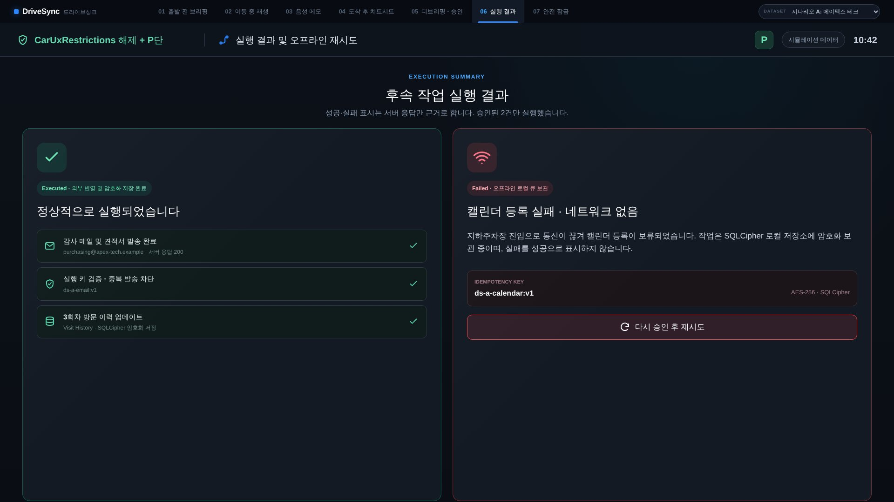
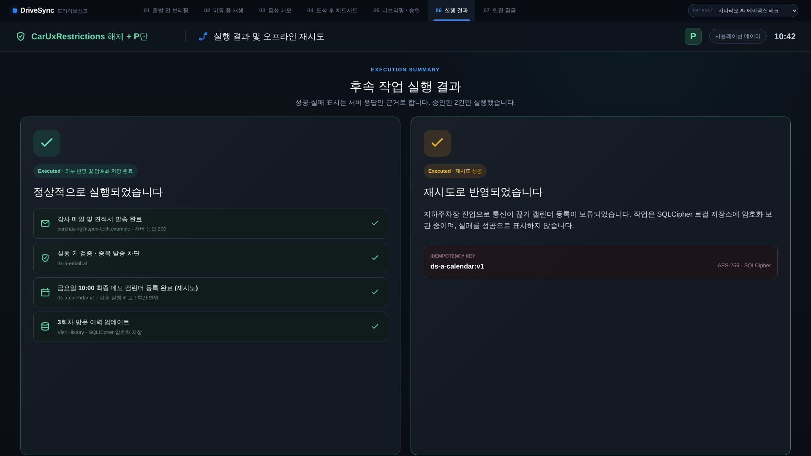
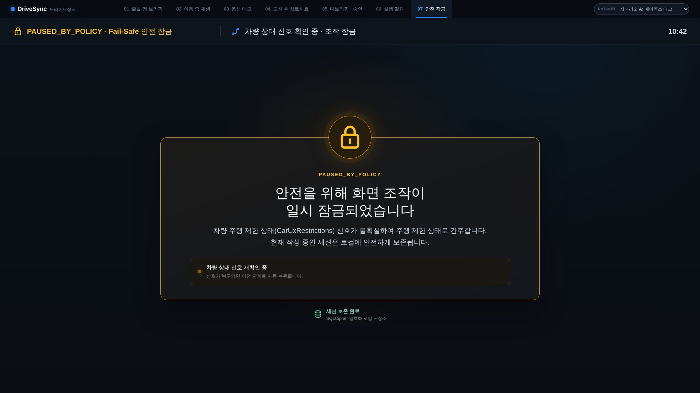

# DriveSync (드라이브싱크)

> **운전 중 떠오른 생각을, 도착 후 실행 가능한 업무로.**
> 외근 영업직을 위한 Pleos Connect 기반 B2B 고객 방문 워크플로 엔진 · 2026 현대자동차그룹 차량용 앱 개발 공모전 출품작

[](https://github.com/ukhwang/DriveSync/actions/workflows/prototype.yml)
[](https://github.com/ukhwang/DriveSync/actions/workflows/domain.yml)
[](https://github.com/ukhwang/DriveSync/actions/workflows/android.yml)
[](https://github.com/ukhwang/DriveSync/actions/workflows/supabase.yml)



> 이 저장소의 모든 거래처·담당자·이메일은 **가상 데이터**입니다. 담당자는 `박OO 팀장` 형식으로 가렸고, 이메일은 예약 도메인 `.example`만 씁니다. 화면에는 `시뮬레이션 데이터` 배지가 붙습니다.

## 심사위원용 1분 요약

DriveSync는 내비게이션 목적지·잔여 시간(ETA)과 플랫폼의 주행 UX 제한 상태(CarUxRestrictions)를 고객 방문 세션에 연결합니다. 이동 시간은 안전하게 **듣기**와 **단발성 메모**에 쓰고, 정차 시간은 대화면에서 **확인·승인**에 씁니다.

```
방문 전 브리핑 → 이동 중 음성 브리핑·단발성 메모 → 도착 후 치트시트 → 미팅 후 디브리핑 → 승인형 후속 실행
```

| 심사 기준 | 저장소가 보여주는 것 |
|---|---|
| 차량 특화성 | 화면 허용 범위는 **CarUxRestrictions 하나로** 결정, P단은 정차 확인용 보조 신호(`CarUxRestrictions 해제 + P단`). 신호가 불확실하면 자동 안전 잠금(`PAUSED_BY_POLICY`). ETA에 맞춰 브리핑 30초 / 1분 / 2분 자동 조절 |
| 창의성 | 출발·주행·도착·재출발 이벤트로 **세션이 스스로 진행**(10상태 상태 머신). 고객별 방문 이력과 못 끝낸 작업이 다음 브리핑에 반영 |
| 기술 활용성 | LLM은 서버 경유로만 호출, 입·출력 스키마 검증. 항목마다 **[내 기록] / [AI 추론]** 구분. **항목별로 승인한 작업만 실행**, 같은 실행 키로 1회만 발송, 실패는 `Failed → Retry` |
| 사업성 | 검증되지 않은 수치는 가설로 표기. 인터뷰 가이드·검증 지표·로드맵 준비 ([기획서](docs/planning/proposal.md#4-사업성)) |

## 제출물 안내 (공모전 제출 요건)

| 요건 | 내용 |
|---|---|
| 앱 이름 및 한 줄 소개 | **DriveSync (드라이브싱크)** — 운전 중 떠오른 생각을, 도착 후 실행 가능한 업무로. 외근 영업직을 위한 Pleos Connect 기반 B2B 고객 방문 워크플로 엔진 |
| 실행 방법 | [실행 방법](#실행-방법) — 웹 시연 프로토타입(3분) · 차량 앱(Android) · 서버 함수 |
| 테스트 환경 및 필요한 설정 | [테스트 환경](#테스트-환경) |
| Pleos Connect 에뮬레이터 버전과 화면 규격 | [Pleos Connect 에뮬레이터·화면 규격](#pleos-connect-에뮬레이터화면-규격) |
| APK 파일 위치 | [`apk/DriveSync_DriveSync_release.apk`](apk/DriveSync_DriveSync_release.apk) ([APK](#apk-release)) |

## 실행 방법

| 대상 | 명령 | 준비물 |
|---|---|---|
| 웹 시연 프로토타입 | `cd prototype && npm ci && npm run dev` → `http://localhost:5173` | Node.js 22 이상 |
| 차량 앱(Android) | `cd android && ./gradlew assembleDebug installDebug` | JDK 17 이상, Android SDK 35, AAOS 에뮬레이터 |
| 차량 앱 판단 규칙 테스트 | `cd android && ./gradlew -Pdomain.only=true test` | JDK 17 이상 (Android SDK 불필요) |
| 서버 함수 | `cd supabase/functions && deno task ci` | Deno 2 |
| 릴리스 APK 재빌드 | GitHub Actions `Android app` → `release` job의 아티팩트 | GitHub Actions |

자세한 절차는 아래 [웹 시연 프로토타입 실행](#웹-시연-프로토타입-실행-3분), [다른 구성 요소 실행](#다른-구성-요소-실행)에 이어집니다.

## 테스트 환경

| 구분 | 버전 · 조건 |
|---|---|
| 차량 앱 (Kotlin) | JDK 17 이상 (CI는 Temurin 21) · Kotlin 2.1.21 · AGP 8.10.1 · Gradle 8.14.3(wrapper) · Android SDK Platform 35 + Build-Tools 35.0.0 · `compileSdk 35` / `minSdk 31` / `targetSdk 35` |
| 웹 시연 프로토타입 | Node.js 22 이상 · Vite + React + TypeScript(strict) · Chrome/Edge 최신 버전 |
| 서버 함수 | Deno 2 · Supabase CLI (로컬 스택을 띄울 때만) |
| 자동 테스트 | 웹 14 · 차량 앱 Kotlin 42 · 서버 15 = **71개** (`npm run ci` · `./gradlew test` · `deno task ci`) |

설정은 `android/local.properties`(저장소 제외)에 둡니다. 서버 없이 화면만 보려면 비워 두면 됩니다.

| 키 | 기본값 | 설명 |
|---|---|---|
| `SUPABASE_URL` / `SUPABASE_ANON_KEY` | (빈 값) | 서버 함수 주소. 비워 두면 로컬 Supabase(`http://localhost:54321`)를 보고, 서버가 없으면 가상 데이터로 동작 |
| `DRIVESYNC_DEMO_EMAIL` / `DRIVESYNC_DEMO_PASSWORD` | (빈 값) | 시연 계정. 비어 있으면 로그인 단계를 건너뜁니다 |
| `DRIVESYNC_MEMO_MAX_SECONDS` | `120` | 단발성 음성 메모 최대 길이(초). 설정 화면에서 변경 가능하며 발화가 끝나면 자동 저장 |
| `DRIVESYNC_USE_CAR_API` | `false` | `true`면 실제 `CarUxRestrictions`/`CarPropertyManager`, `false`면 시뮬레이터 패널(화면에 시뮬레이션 배지) |
| `DRIVESYNC_KEYSTORE_PATH` · `DRIVESYNC_KEYSTORE_PASSWORD` · `DRIVESYNC_KEY_ALIAS` · `DRIVESYNC_KEY_PASSWORD` | (빈 값) | 릴리스 서명 키. **저장소에 포함하지 않습니다** ([APK](#apk-release)) |
| `sdk.dir` | — | Android SDK 경로 ([`android/local.properties.example`](android/local.properties.example)) |

## Pleos Connect 에뮬레이터·화면 규격

| 항목 | 내용 |
|---|---|
| 플랫폼 기준 | 표준 **AAOS(Android Automotive OS) 12 이상** — `minSdk 31`, `targetSdk 35`, `compileSdk 35` |
| 사용 API | `CarUxRestrictionsManager`(표준 AAOS, `useLibrary("android.car")`), `CarPropertyManager`(기어·속도). Pleos 전용 SDK 없이도 표준 AAOS API만으로 안전 정책이 동작하고, Pleos SDK는 수령 후 같은 인터페이스에 바인딩합니다 |
| 화면 규격 | **1920×1080, 16:9 가로(landscape) cockpit 디스플레이**. `screenOrientation="landscape"`, 대화면(센터 디스플레이) 기준 레이아웃. 웹 프로토타입도 같은 16:9 비율로 맞췄습니다 |
| CI 빌드 환경 | ubuntu-latest · Temurin JDK 21 · Android SDK 35에서 `assembleDebug`/`test`/`assembleRelease` 통과 |
| Pleos Connect 전용 에뮬레이터 | 주최측 Pleos Connect 에뮬레이터와 Pleos SDK(NaviHelper·STT·TTS·FusedLocation)는 **SDK 수령 후 2차 PT 전까지 실연동 예정**입니다. 그 전까지는 `DRIVESYNC_USE_CAR_API=false`의 시뮬레이터 패널로 CarUxRestrictions·기어 P/D 신호를 재현해 10상태 흐름을 그대로 시연합니다 |

## APK (release)

- 위치: [`apk/DriveSync_DriveSync_release.apk`](apk/DriveSync_DriveSync_release.apk) — 공모전 제출용 release 빌드(R8 minify 적용, release 키로 서명).
- 빌드 결과: **23.4 MB (24,556,804 bytes)** · SHA-256 `cb85fc218e0c73347a70f8b36508039eee48cba9b8231147ed1c02592f0b45eb` · GitHub Actions `Android app` → `release` job에서 `apksigner verify` 통과(APK Signature Scheme v2, 서명자 1, RSA 4096).
- 서명 키는 **저장소에 커밋하지 않습니다**. CI(`Android app` → `release` job)가 `apksigner verify`로 서명을 확인하고, 키를 Secrets(`DRIVESYNC_KEYSTORE_BASE64`·`DRIVESYNC_KEYSTORE_PASSWORD`·`DRIVESYNC_KEY_ALIAS`·`DRIVESYNC_KEY_PASSWORD`)로 주면 그 키로, 없으면 실행마다 임시 키로 서명합니다.
- 설치: `adb install -r apk/DriveSync_DriveSync_release.apk` (Android Automotive 12+ / `android.hardware.type.automotive` 필요). 빌드에 서버 주소가 없으면 앱은 `DemoSeed` 가상 데이터와 시뮬레이터 패널로 동작하며 모든 화면에 `시뮬레이션 데이터` 배지가 붙습니다.

**자동 테스트 71개**가 push마다 기획서의 약속을 검증합니다: 주행 제한 중 금지 기능 접근 0건 · 승인 없는 실행 0건 · 중복 발송 0건 · 스키마 위반 결과 표시 0건 · 표기 원칙(상단 바·출처 배지·시뮬레이션 배지·개인정보) 위반 0건.
(웹 프로토타입 14 · 차량 앱 Kotlin 42 · 서버 15) → 근거 상세: [`docs/judging.md`](docs/judging.md)

## 웹 시연 프로토타입 실행 (3분)

7개 상태를 브라우저에서 바로 시연할 수 있습니다. 필요한 것: [Node.js](https://nodejs.org) 22 이상.

```bash
git clone https://github.com/ukhwang/DriveSync.git
```

```bash
cd DriveSync/prototype
```

```bash
npm ci
```

```bash
npm run dev
```

브라우저에서 `http://localhost:5173` 을 엽니다. 가로형 차량 대화면 비율(16:9)이며 **1920×1080 전체 화면**에서 가장 잘 보입니다. 위쪽 탭(01~07)으로 상태를 바꾸고, 오른쪽 위 `DATASET`으로 가상 시나리오 A·B·C를 바꿉니다.

검사만 돌릴 때(타입 검사 → 표기 원칙 테스트 → 빌드):

```bash
npm run ci
```

## 7개 상태 시연 가이드

| # | 상태 | 이렇게 시연하세요 | 확인할 점 |
|---|---|---|---|
| 01 | **출발 전 브리핑** (정차) | 목적지·ETA 18분 확인 → `주행 브리핑 준비 완료` | 상단 바 `CarUxRestrictions 해제 + P단` · ETA 18분 → "중거리 브리핑(1분)" 자동 매칭 · 카드마다 `[내 기록]`/`[AI 추론]` |
| 02 | **이동 중 브리핑 재생** (주행 제한) | `일시정지` ↔ `계속 재생`, `중지` 눌러보기 → `음성 메모 (1-Tap)` | 상단 바 `CarUxRestrictions 활성 · D단 주행 제한` · 화면에는 목적지·ETA·재생 제어·메모 버튼만 · 일방향 재생(질문 없음) |
| 03 | **단발성 음성 메모** (주행 제한) | 그대로 두면 녹음 → 약 8초 뒤 `저장됨` | 원형 음파 + "최대 2분"만 표시(설정으로 변경 가능, 말이 끝나면 자동 저장, 남은 시간은 마지막 15초만) · **주행 중에는 전사문·AI 분류·꼬리질문 없음**, 확인음만 |
| 04 | **도착 후 미팅 치트시트** (정차 · P단) | 좌우 화살표로 원기둥 회전 → 가운데 카드 탭 → `내용 수정` | 3D 원기둥 캐러셀: 핵심 3줄 / 우려사항 / 예상 질문 / 이동 중 메모 · 줄마다 출처 배지(수정한 AI 줄은 `[내 기록]`으로 바뀜) · **승인·발송 버튼 없음** |
| 05 | **디브리핑 + 개별 승인** (정차) | 메일 `검토 시작` → 본문 수정 → `이 항목 승인`, 일정도 같은 방법 → `승인된 N건 실행` | 왼쪽 디브리핑 원문 `[내 기록]` · 오른쪽 메일·일정이 각각 `Draft → Review → Approved` · 승인 0건이면 실행 버튼 비활성 · 승인 후 수정하면 다시 Review(버전 +1) |
| 06 | **실행 결과 + 오프라인 재시도** (정차) | 실패 카드 `다시 승인 후 재시도` → `연결 복구 (시뮬레이션)` | 메일 `Executed` · 지하주차장에서 일정 등록 `Failed` → 다시 승인 → `Retry` → `Executed` · **같은 실행 키**(`ds-a-calendar:v1`) 재사용 |
| 07 | **신호 오류 안전 잠금** | 탭만 전환 | `PAUSED_BY_POLICY` · 조작 잠금 · 세션은 암호화 로컬 저장소에 보존 |

| | | |
|---|---|---|
|  02 이동 중 재생 |  03 단발성 음성 메모 |  04 미팅 치트시트 |
|  04 상세·수정 |  05 개별 승인 |  06 Failed → 재승인 |
|  06 Retry → Executed |  07 안전 잠금 | |

## 표기 원칙 (테스트로 강제)

[`prototype/src/compliance.test.tsx`](prototype/src/compliance.test.tsx)가 어기면 CI가 실패합니다.

1. 정차 화면 상단 바는 `CarUxRestrictions 해제 + P단`을 **함께** 표기 (P단 단독 금지)
2. 브리핑·치트시트·AI 초안 항목마다 `[내 기록]` / `[AI 추론]` 출처 배지
3. 가상 거래처·데이터가 보이는 화면(01~06)에 `시뮬레이션 데이터` 배지
4. 개인정보 0건: 담당자 이름 마스킹, 이메일은 `.example`만, 전화번호 없음

## 저장소 구조

```
prototype/          웹 시연 프로토타입 (Vite + React + TypeScript strict) — 7개 상태
  src/data/         시연 문구·가상 데이터·상단 바 문구 (디자인이 바뀌면 여기만 수정)
  src/states/       State01Briefing … State07Locked (화면은 props만 받는 UI)
  src/hooks/        상태 전환, 항목별 승인, 실패→재시도 로직
android/            Kotlin · AAOS (Pleos Connect) 차량 앱 — Gradle 멀티모듈
  core/safety       Safety & Policy Controller (CarUxRestrictions 단일 기준, Fail-Safe)
  core/session      10상태 세션 상태 머신 + ETA 브리핑 플래너
  core/action       6단계 승인형 Action Engine (실행 키로 중복 방지)
  core/vehicle      Vehicle Context Adapter (Real / Mock 분리)
  core/ai           서버 함수 클라이언트 + 응답 재검증
  core/data         Room + SQLCipher 암호화 저장, Android Keystore
  core/voice        TTS(오디오 포커스 양보·대기열) / 단발성 STT
  app               Compose UI, 실제 CarUxRestrictions 어댑터
supabase/           Postgres(RLS) + Edge Functions(Deno, Zod) — LLM 프록시, 메일 발송, 사용량 제한, 동의
schemas/            JSON Schema (Zod 계약에서 생성, CI가 동기화 검증)
docs/               기획서, 아키텍처, 상태 머신, 안전 정책, 시연 대본, 로드맵, 인터뷰 가이드, 스크린샷
design/             디자인 토큰, 화면 명세, Figma 프롬프트
```

### 웹 프로토타입과 차량 앱의 관계

- **웹 프로토타입**(`prototype/`)은 Figma Make 시안을 가져와 기획서 원칙에 맞게 고친 **시연용 화면**입니다. 서버 연결 없이 가상 데이터로 7개 상태를 보여줍니다. 이 폴더부터는 GitHub가 원본이며, Make에서 다시 내보내 덮어쓰지 않습니다.
- **차량 앱**(`android/`)은 Pleos Connect에 올릴 실제 Kotlin 앱입니다. 판단 규칙(안전 정책·상태 머신·승인 엔진)은 순수 Kotlin으로 테스트되고, Pleos 전용 SDK는 수령 후 연결합니다.
- 웹 시연물은 정적 화면이라 서버 렌더링이 필요 없어, Figma Make가 만든 Vite + React 구성을 그대로 유지했습니다.

## 다른 구성 요소 실행

```bash
cd android && ./gradlew -Pdomain.only=true test
```

차량 앱의 판단 규칙 테스트 (Android SDK 불필요, JDK 17 이상).

```bash
cd supabase/functions && deno task ci
```

서버 함수 형식·린트·타입 검사·테스트 (Deno 2). 로컬 Supabase 실행과 배포는 [`docs/backend.md`](docs/backend.md), 차량 앱 설치는 [`android/local.properties.example`](android/local.properties.example)를 참고하세요.

## 진행 상태와 남은 일

| 단계 | 상태 |
|---|---|
| 판단 규칙(안전 정책·상태 머신·ETA 브리핑·승인 엔진) + 테스트 | 완료 |
| 서버(LLM 프록시·스키마 검증·사용량 제한·동의·메일 발송 API) + 테스트 | 완료 (호스팅 배포 전) |
| 7개 상태 웹 시연 프로토타입 | 완료 |
| Kotlin 차량 앱 빌드 | CI 통과 · release APK 서명 빌드 완료([`apk/`](apk/)), Pleos Connect 에뮬레이터 구동 검증 예정 |
| Pleos 전용 SDK(NaviHelper·STT·TTS) 연결 | SDK 수령 후 |
| 현직자 예비 인터뷰 · 시나리오 테스트 | 예정 ([가이드](docs/interviews/README.md)) |

상세: [`docs/roadmap.md`](docs/roadmap.md)

## 문서

- [기획서](docs/planning/proposal.md) · [심사 기준별 근거](docs/judging.md) · [본선 시연 대본](docs/demo-script.md)
- [아키텍처](docs/architecture.md) · [상태 머신](docs/state-machine.md) · [안전 정책](docs/safety-policy.md) · [백엔드](docs/backend.md)
- [화면 명세](design/screens.md) · [디자인 변경 절차](design/README.md) · [Figma Make 동기화 프롬프트](design/figma-make-sync-prompt.md)
