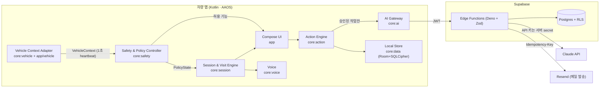

# 아키텍처

기획서 3-③의 6개 모듈을 Gradle 모듈로 1:1 대응시켰습니다. 판단 규칙은 모두 순수 Kotlin 모듈에 있어 Android SDK 없이 테스트됩니다. Android 모듈은 이 규칙을 I/O에 연결만 합니다.

## 모듈

| 모듈 | 책임 | 핵심 타입 |
|---|---|---|
| `core:model` | 6개 엔터티 + 차량 신호 모델. `Signal`은 Available / Unsupported / Unavailable을 구분해 "미지원"과 "실패"를 실제 값처럼 쓰지 못하게 함 | `VehicleContext`, `Signal`, `FollowUpAction`, `Insight` |
| `core:vehicle` | 차량 맥락 포트. Mock은 항상 `SIMULATED`로 표시 | `VehicleContextSource`, `MockVehicleContextSource` |
| `core:safety` | 화면·입력 허용 범위 계산, Fail-Safe | `SafetyPolicy`, `Feature`, `PolicyState` |
| `core:session` | 세션 상태 머신(순수 reducer), ETA 브리핑 분량과 재계산 | `SessionStateMachine`, `BriefingPlanner` |
| `core:action` | 6단계 전이 규칙, 실행 키, 동시 실행 방지 | `ActionEngine`, `ActionTransitions` |
| `core:ai` | Edge Function 호출, 응답 재검증, 오류를 명시적 결과로 변환, Supabase Auth | `EdgeFunctionClient`, `ContractValidator`, `HttpActionExecutor` |
| `core:data` | 암호화 로컬 저장, Keystore 비밀 관리, 세션 스냅샷 | `DriveSyncDatabase`, `KeystoreSecretStore` |
| `core:voice` | TTS 대기열·오디오 포커스 양보, 단발성 STT | `SpeechOutput`, `SpeechInput` |
| `app` | 실제 CarUxRestrictions 어댑터, ViewModel, 화면 | `CarApiVehicleContextSource`, `DriveSyncViewModel`, `DriveSyncRoot` |

## 상태 관리 원칙

- **영속/서버 상태**: Room(→ Supabase)이 원본입니다. UI는 `Flow`로 관찰만 하고 UI 상태 객체에 복사하지 않습니다 (`visits`, `notes`, `insight`, `actions` 플로우).
- **UI/클라이언트 상태**: `UiState`(`StateFlow`)는 세션 단계, 정책, 비동기 진행 상태, 메모 캡처 같은 화면 상태만 가집니다.
- **낙관적 반영**: 메모 저장과 Review/Approved 전환은 로컬에 즉시 반영합니다. **Executed는 서버 응답으로만** 반영합니다.

## 오류 흐름

| 상황 | 동작 |
|---|---|
| 네트워크 단절 | 메모·디브리핑 원문은 로컬에 먼저 저장. 실행은 `Failed → Retry`로 남고 다음 정차 때 재승인 |
| LLM 출력 스키마 위반 | 서버 422 → 앱은 결과를 표시하지 않고 "원문 보존" 안내 |
| 동의 없음 | 서버 403 `consent_required` → 정차 중 동의 다이얼로그 |
| 사용량 초과 | 429 + Retry-After |
| 차량 신호 끊김/정지 | `PAUSED_BY_POLICY`, 주행 제한 화면. 신호 복구 시 이전 단계로 자동 복귀 |
| 앱 강제 종료 | 암호화된 세션 스냅샷으로 복구. 실행 중이던 작업은 승인 대기로 되돌림 |
