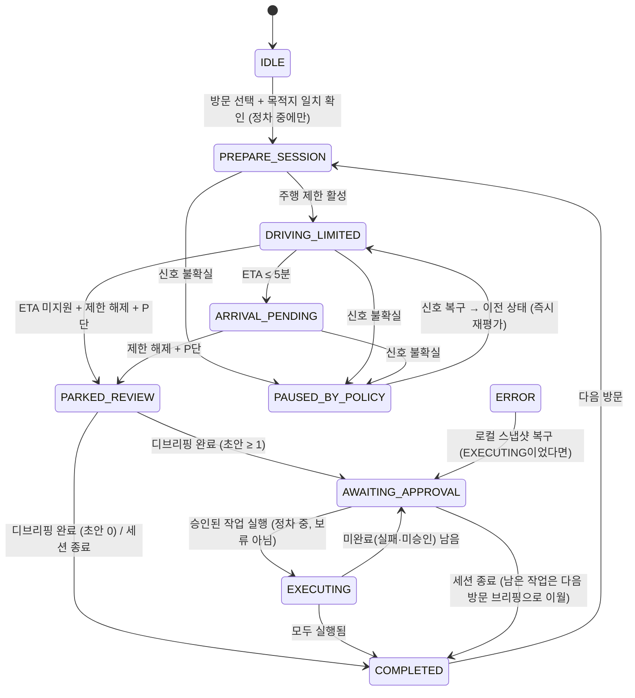
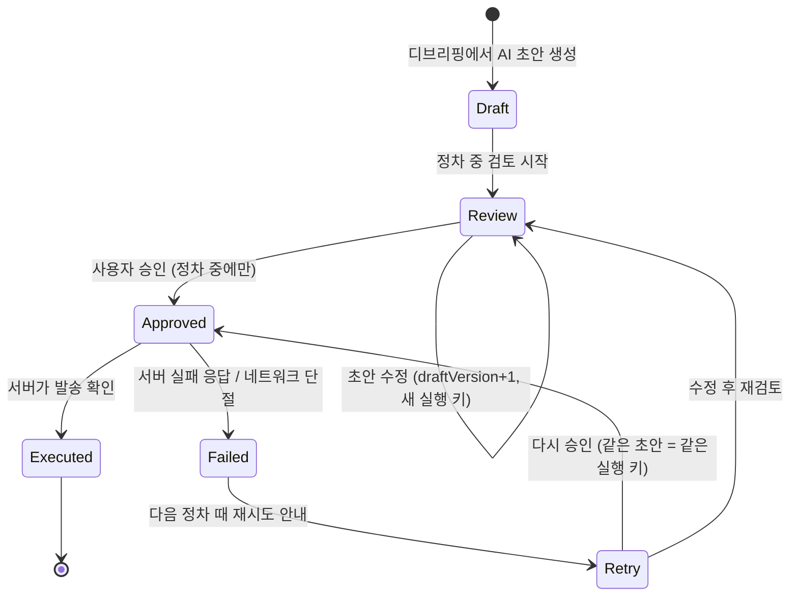

# 상태 머신

구현: [`SessionStateMachine`](../android/core/session/src/main/kotlin/com/drivesync/core/session/SessionStateMachine.kt) · 테스트: `SessionStateMachineTest`

## 세션 (10 상태)

- `AWAITING_APPROVAL` 중 주행이 시작되면 상태는 유지하고 `approvalsOnHold = true` (승인 보류). 실행 요청은 거부됩니다.
- `PARKED_REVIEW`, `AWAITING_APPROVAL`에서도 신호가 불확실하면 `PAUSED_BY_POLICY`로 갑니다.
- 어떤 상태든 `Fatal` → `ERROR`. 복구는 `RecoveredFromLocal(snapshot)`.

## 후속 작업 (6 상태)

구현: [`ActionTransitions`](../android/core/action/src/main/kotlin/com/drivesync/core/action/ActionEngine.kt) · 서버: [`execute-action`](../supabase/functions/execute-action/handler.ts)

| 불변식 | 강제 위치 |
|---|---|
| 승인 안 된 작업은 실행기에 도달하지 않음 | `ActionEngine.execute` + 서버 실행 키 검증 |
| `Executed`는 서버 성공 응답으로만 | `ActionEngine` / `HttpActionExecutor` |
| 같은 실행 키는 한 번만 발송 | `action_executions` PK + Resend `Idempotency-Key` |
| 클라이언트는 `actions.status`를 직접 쓸 수 없음 | RLS (select/delete만 허용) |
